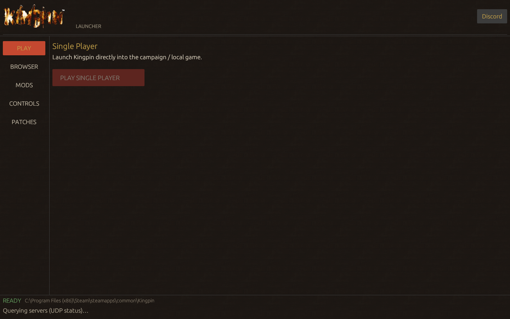
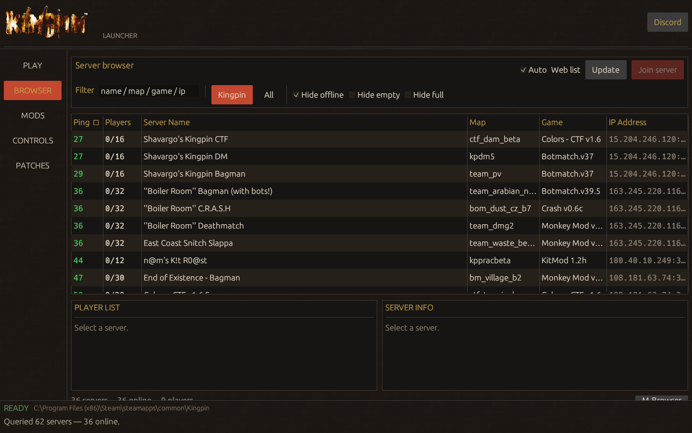
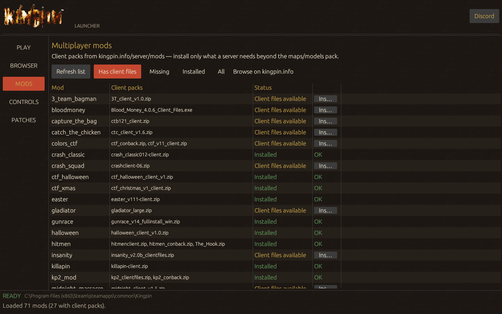
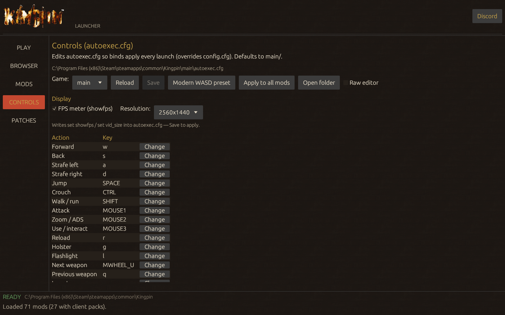
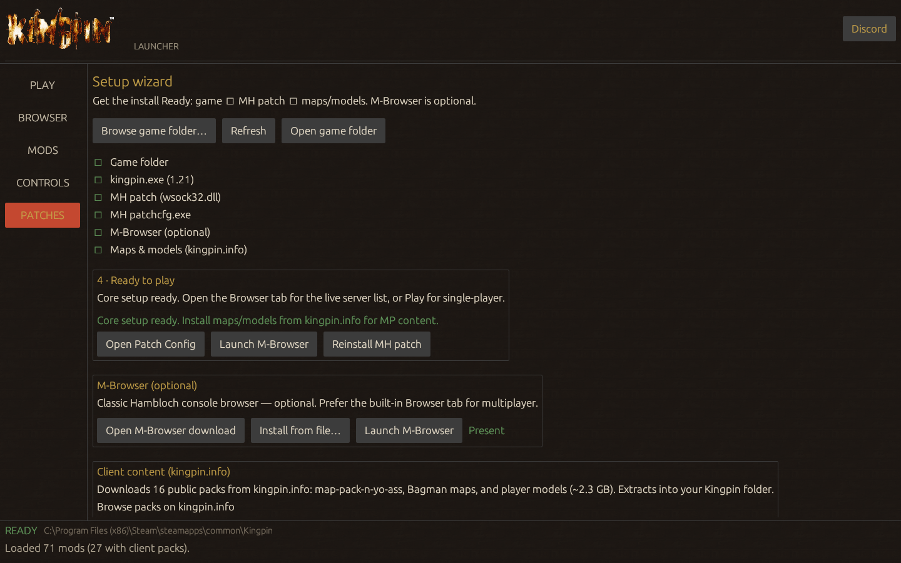

# Kingpin Launcher

Noir Windows GUI launcher for *Kingpin: Life of Crime*.

- **Play** — single-player (`kingpin.exe`)
- **Browser** — ASE-style live server list ([daily mirror](https://github.com/shavargo/kingpin-servers-mirror) + UDP status); Join with `+set game` / `+connect`
- **Mods** — browse kingpin.info `server/mods`, see which have `client_files`, install missing client packs
- **Patches** — checklist wizard (locate → 1.21 → MH patch → optional classic M-Browser → maps/models from kingpin.info)
- **Controls** — edit `autoexec.cfg` key binds
- **Discord** — [community invite](https://discord.gg/SWMG6FD)

## Requirements

- Windows
- Kingpin from **Steam** or **GOG** (both ship v1.21)
- Rust stable (`rustup`) to build
- Visual Studio Build Tools with the MSVC C++ workload (for `link.exe`)
- 7-Zip only needed for `.rar` / `.7z` mod client packs (maps/models installer uses `.zip`)

## Build / run

```powershell
cargo run --release
```

Release binary: `target\release\kingpin-launcher.exe`

Copy the exe anywhere you like. It writes `launcher.toml` and a `cache\` folder next to itself (game path, last tab, mirrored server list).

## Notes

- Writing into `Program Files (x86)\Steam\...` may require **Run as administrator** when installing the MH patch, maps/models, or copying M-Browser.
- MH patch is downloaded from [kingpin.info](https://www.kingpin.info/download/index.php?dir=kingpin%2Fpatches%2Funofficial%2Fwindows%2Fmh%27s_kingpin_patch%2F).
- Client maps/models are downloaded from [kingpin.info map-packs](https://www.kingpin.info/download/index.php?dir=kingpin/main/maps/map-packs/) (map-pack-n-yo-ass, Bagman, player models).
- Classic M-Browser is **optional** (download: [M Hambloch](https://forum.hambloch.com/kingpin.php?dl=mbrowser)). The Browser tab uses the built-in list by default.

## Screenshots

### Play



### Browser



### Mods



### Controls



### Patches


